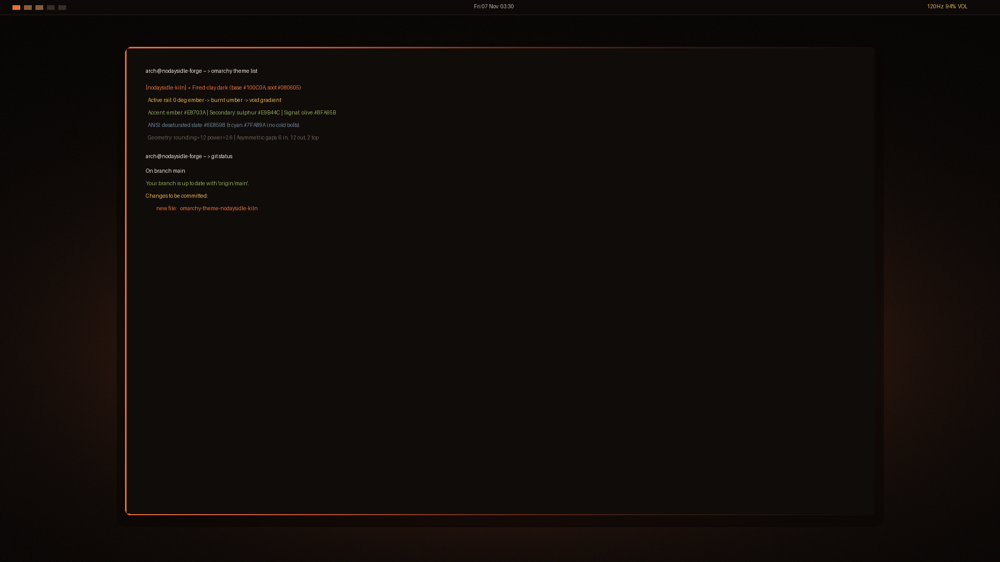

# nodaysidle Kiln — Omarchy Theme

> *"A fired-clay dark that reads like a lit forge instead of a server rack."*

An artisanal, warm-spectrum theme for **Omarchy / Hyprland**, custom-tailored for the **nodaysidle** ecosystem.

Every theme in the workspace historically lived in the cold half of the spectrum — **Aura** is electric cobalt, **Carbon Noir** is platinum, **Royal Green & Red** are jewel tones. **Kiln** fills that void: a grounded, fired-clay dark anchored by deep red-brown undertones, glowing embers, sulphur warnings, and bone typography.



---

## Design System & Color Tokens

Anchored in an unyielding warm dark ground (`#100C0A` — not neutral gray) paired with organic bone typography (`#EDE3D6` — avoiding chromatic clash against warm black) and surgical ember focal points:

| Token | Hex | Role in Ecosystem |
| :--- | :--- | :--- |
| **Kiln Void** | `#100C0A` | Primary background (deep black with natural red-brown depth) |
| **Kiln Soot** | `#080605` | Sunken surfaces, popovers, lockscreen base |
| **Kiln Raise** | `#1A1411` | Elevated cards, tabs, and container acrylic |
| **Clay Hairline** | `#3A2C24` | Inactive window borders, dividers, subtle frames |
| **Ember** | `#E8703A` | Primary accent, forge mouth rail, cursor focus |
| **Sulphur** | `#E9B44C` | Warning states, secondary values, hover highlights |
| **Olive Signal** | `#8FA65B` | Success, connected badges, clean git additions |
| **Brick** | `#D64545` | Error states, alerts, destructive triggers |
| **Bone** | `#EDE3D6` | Primary high-contrast text (eliminates white glare) |
| **Ash** | `#6B5B4E` | Muted labels, comments, secondary telemetry |
| **Slate Umber** | `#6E8598` | Deliberately desaturated blue ANSI (no cold bolts) |
| **Clay Cyan** | `#7FA89A` | Deliberately desaturated cyan ANSI (calm telemetry) |

---

## Key Architectural Features

### 1. The Forge Mouth (0° Active Border Gradient)
A 3px active border rendered as a horizontal 0° gradient spanning `ember (#E8703A) → cooling ember (#C9562A) → burnt umber (#6A2E18) → clay shadow (#2A1A12) → void (#100C0A)`. As Hyprland paints across the window box, the focused window reads as a warm radiant rail falling off into soot.
* **Inactive Hairline:** `rgba(3A2C24AA)` — visible framing that never competes for visual focus.
* **Zero Redraw Overhead:** Border angle animation (`borderangle`) is explicitly disabled; the focused window is a still photograph of heat, preserving Arc iGPU frames.

### 2. Clay Geometry & Heavy Tone
* **Curvature:** `rounding = 12` with `rounding_power = 2.6`. Softer than standard squircles — clay bends before it cracks.
* **Asymmetric Gap Rhythm:** `gaps_in = 6`, `gaps_out = { top = 2, right = 12, bottom = 12, left = 12 }` so the status bar sits tight against the screen edge like a kiln lintel.
* **Depth Without Mud:** Inactive windows dim by `0.18` with a warm-tinted shadow (`rgba(0A0503AA)`, range 16). Blur stays disabled to avoid warm haze turning into visual mud.

### 3. Ghostty & Herdr Cockpit Integration
Engineered from the ground up for **Ghostty** and the **Herdr** agent workspace multiplexer:
* **Ghostty Palette:** Native [`ghostty.conf`](ghostty.conf) mapping the 16-color ANSI space to Kiln tokens with ember block cursor.
* **Live Retinting:** Hook automatically signals running Ghostty instances via `killall -SIGUSR2 ghostty` and reloads Herdr via `herdr server reload-config`.
* **Fish Shell Highlighting:** Dynamically updates universal fish syntax highlighting on theme activation.

### 4. Analogue Lintel Bar & Surfaces
`shell.toml` configures an architectural status surface:
* **Lintel Bar:** 30px height with 1px `#2A1F19` bottom rule and `#0C0908` background at 0.94 alpha.
* **Ember Ticks:** Workspaces render as minimal ember ticks (`style = "ticks"`) rather than bulky pills.
* **Tabular Clock:** Centered tabular monospace clock (`%a %d %b  %H:%M`).
* **Soot Surfaces:** Notification toasts and OSD surfaces styled in `#080605` with ember and clay hairline borders.

### 5. Slow, Heavy Motion
Driven by a bespoke cubic bezier pair:
* `kilnSettle` `(0.22, 1.0, 0.28, 1.0)`: Windows enter with weight and settle firmly into place.
* `kilnDismiss` `(0.40, 0.0, 1.0, 1.0)`: Swift, clean dismiss.

### 6. Curated Native 2560×1440 Wallpapers
Includes 3 native high-resolution wallpapers tailored for wide displays:
* `01-kiln-forge-ember.png`: Atmospheric forge hearth bloom with organic film grain.
* `02-kiln-clay-minimal.png`: Ultra-minimal matte clay ground with a subtle horizon heat seam.
* `03-kiln-burnt-monolith.png`: Monolithic architectural facets in umber, clay hairline, and ember.

---

## Installation & Activation

### 1. Register the Theme
Clone and run the installer from inside the repository:

```bash
git clone https://github.com/nodaysidle/omarchy-theme-nodaysidle-kiln.git
cd omarchy-theme-nodaysidle-kiln
chmod +x install uninstall hooks/nodaysidle-kiln
./install
```

### 2. Activate with Omarchy
```bash
omarchy theme set nodaysidle-kiln
```

### 3. Cycle Wallpapers
```bash
omarchy theme bg next
```
*(or press `Super + Ctrl + Space` for the visual wallpaper picker)*

---

## File Architecture

```
omarchy-theme-nodaysidle-kiln/
├── colors.toml               # Master color tokens + 16-color ANSI map
├── hyprland.lua              # 0° ember gradient rail, 12px squircle, kilnSettle curve
├── shell.toml                # 30px lintel bar, ticks, controls, popups, and OSD
├── ghostty.conf              # Ghostty terminal palette & cursor definition
├── foot.ini                  # Foot terminal configuration
├── btop.theme                # Telemetry skin for system monitoring
├── gtk.css / gtk3.css        # Warm GTK styling
├── hyprlock.conf             # Hyprlock screen with ember gradient ring
├── gum.env.conf              # Gum environment configuration
├── preview.png               # High-res preview card for Omarchy theme picker
├── install / uninstall       # Symlink & hook registration scripts
├── hooks/
│   └── nodaysidle-kiln       # Omarchy lifecycle hook (Fish, Ghostty, Herdr, GTK)
└── backgrounds/              # Three bespoke 2560×1440 wallpapers
```

---

## Built for NODAYSIDLE
Part of the [nodaysidle](https://github.com/nodaysidle) workspace — relentless shipping, zero compromise.
